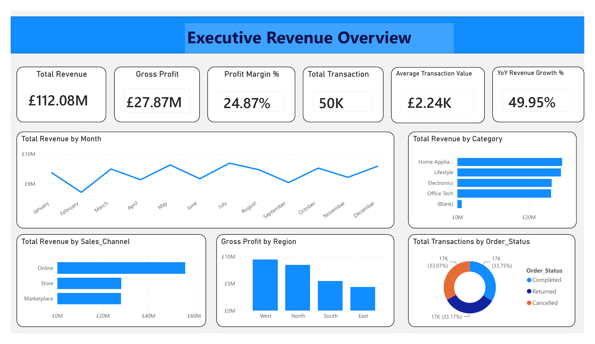
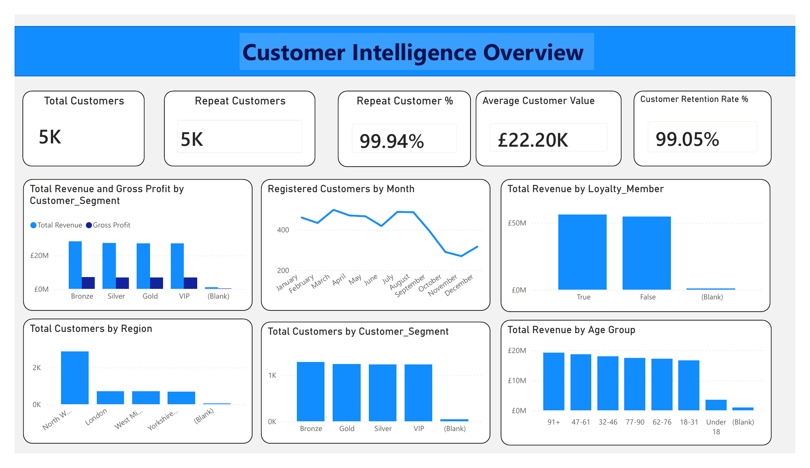
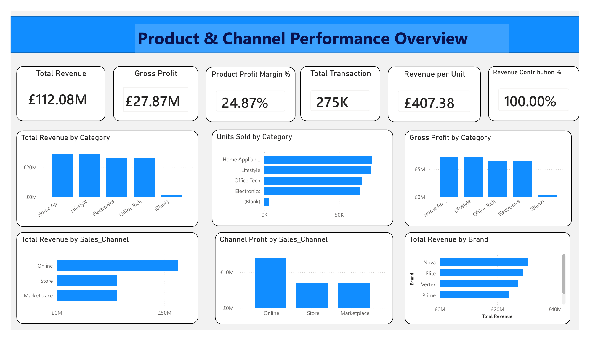
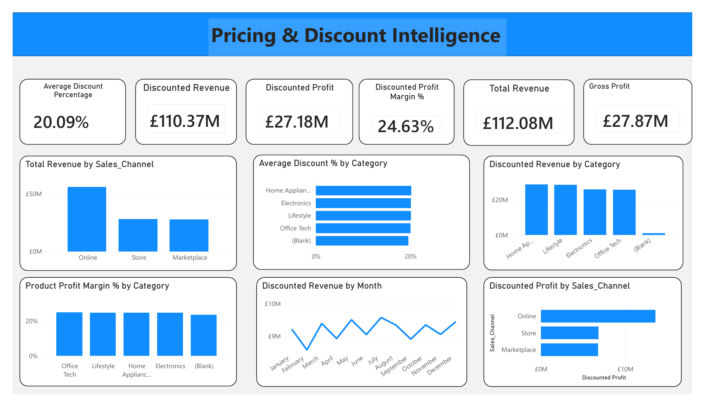

# RetailMax | Revenue Intelligence & Customer Profitability

**Amdari project · Power BI · DAX · Commercial analytics**

A four-page Power BI report exploring retail revenue, gross profit, customer behaviour, product performance, sales channels and discount patterns. The project brings these views together to support questions about where sales come from and how much profit they generate.

## Business problem

RetailMax's case-study brief focuses on understanding revenue and customer profitability across an omnichannel retail business. A revenue total alone does not show which channels, products or customer groups contribute to profit, or how discounting relates to commercial performance.

The analysis addresses five questions:

- Which sales channels and product categories generate the most revenue and gross profit?
- How does the displayed monthly revenue profile change?
- How do customer segments and loyalty membership compare?
- How do revenue, profit and discount measures vary across categories and channels?
- Which metric definitions need to be checked before stakeholders rely on the report?

## My contribution

- Developed the Power BI report and arranged the analysis into four focused dashboard pages.
- Created DAX measures for revenue, profitability, customer and discount reporting.
- Compared customer segments, product categories, brands, channels and regions.
- Presented commercial observations and recommendations, with a separate record of metric checks needed in the source model.

**Tools:** Power BI Desktop, DAX and data modelling.

## Dashboard pages

| Page | Main focus |
| --- | --- |
| Executive Revenue Overview | Revenue, gross profit, margin, monthly patterns, category and channel performance, regional profit and order status. |
| Customer Intelligence Overview | Customer counts, repeat purchasing, loyalty, segments, registration patterns and age groups. |
| Product & Channel Performance Overview | Category revenue and profit, units, channel contribution and brand performance. |
| Pricing & Discount Intelligence | Discount measures, category margins, discounted revenue and channel profit. |

[View the four-page report](reports/RetailMax_PowerBI_Report.pdf)

## Selected report outputs

| Measure | Value shown in the export |
| --- | --- |
| Total revenue | £112.08 million |
| Gross profit | £27.87 million |
| Profit margin | 24.87% |

These are displayed case-study outputs, not independently reconciled financial results. The original data and Power BI model are not included in this report-based release. See the [metric definitions and review status](docs/Metric_Definitions.md) before interpreting the figures.

## Observations from the report

- **Online leads the channel comparison.** It has the largest displayed revenue and gross profit bars, making it a useful starting point for a review of channel economics.
- **Home Appliances leads category revenue.** Category rankings should be considered alongside margins, product costs and discounting.
- **West leads the regional gross profit comparison.** The customer page uses a different set of region labels, so the two geographic views need a mapping before they are compared directly.
- **Discounts deserve closer investigation.** The report shows a discounted profit margin of 24.63% against an overall margin of 24.87%. This comparison does not establish that discounting caused the difference.

[Read the observations and recommendations](docs/Insights_and_Recommendations.md).

## Metric review

The saved export includes a transaction card of **50K** on the executive page and **275K** on the product page. Customer repeat and retention measures are also close to 100%, and several charts contain blank categories. These points are documented for validation rather than treated as confirmed business outcomes. The report images retain the original exported values.

[See the review notes](docs/Data_Quality_Notes.md).

## Additional dashboard views

### Customer Intelligence Overview

### Product & Channel Performance Overview

### Pricing & Discount Intelligence

## Repository contents

| Location | Contents |
| --- | --- |
| `dashboards/` | Four PNG exports of the original report pages. |
| `reports/` | The original four-page PDF, renamed for clarity. |
| `docs/` | Observations, metric definitions and data quality notes. |

This release can be viewed without Power BI. It contains the report export and supporting documentation; it does not include a refreshable `.pbix` file, raw data or the original query scripts.

## Project context

Developed as part of my Amdari project work. Recommendations are analytical proposals; no measured increase in revenue, retention or profit is claimed. The data source and usage terms should be established before any raw dataset is added.

**Author:** Oluwatobiloba Olufowobi  
[LinkedIn](https://www.linkedin.com/in/olufowobi365/) · [GitHub](https://github.com/OlufowobiJosh)
